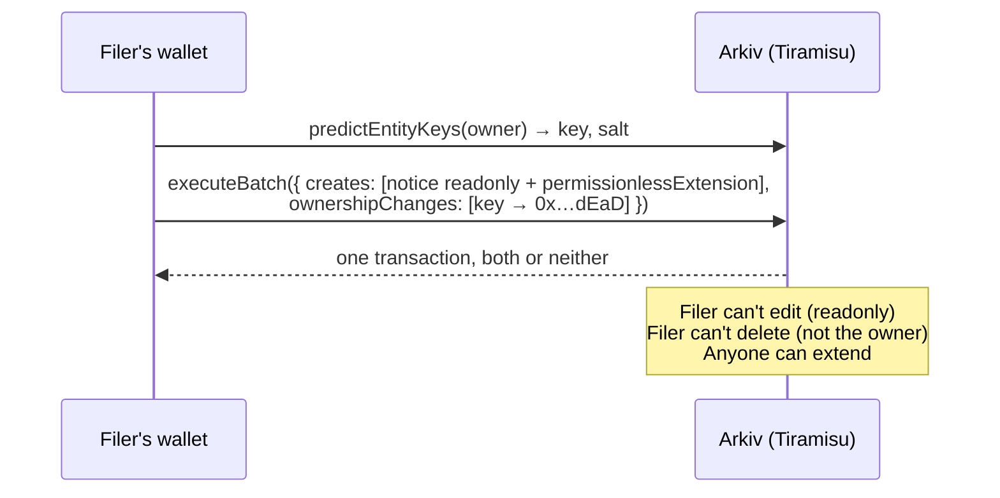

<p align="center">
  
</p>

<p align="center">
  <strong>A public record of censorship that no one can quietly erase — not even us.</strong><br>
  Built on <a href="https://arkiv.network">Arkiv</a> for the Arkiv Global Tour Stop (pre-Devcon 8) · Track: <strong>Censorship Resistance</strong>
</p>

<p align="center">
  <a href="https://takedown-ledger.vercel.app"><strong>Live app</strong></a> ·
  <a href="#-try-it-in-two-minutes">2-minute demo</a> ·
  <a href="arkiv/schema.md">Schema</a> ·
  <a href="arkiv/friction.md">Friction report</a>
</p>

> All notices in the demo are **synthetic**. No real people, no real notices.

---

## 📰 The story

*An illustrative scenario.*

It's late on a Tuesday when a small newsroom receives an order: withhold 37 posts about a municipal contract,
effective immediately. The platform complies by morning. The posts are gone.

So is any trace that the order ever existed.

The newsroom could publish the order, but its site can be pressured too. The platform's transparency report is
voluntary and arrives months later as a single number in a table. The largest public archive of takedown notices
is run by one organisation, and it has already had to restrict public access under pressure.

**Censorship works best when the censorship itself can be erased.** A demand that leaves no record can be
repeated a thousand times without anyone seeing the pattern.

## 💡 The idea

What if filing a takedown notice put it somewhere that:

- **nobody can edit**: not the filer, not us, not whoever sent the order;
- **nobody can delete**: not even a filer who is later pressured to take it back;
- **anyone can keep alive**: the public decides what stays on the record, not an operator;
- **anyone can read and query**: no account, no API key, no gatekeeper.

That's Takedown Ledger. The website is just one reader. The record lives on Arkiv.

## 🔁 How it works: four moves

| | Move | What happens on Arkiv |
|---|---|---|
| 1 | **File** | A notice becomes an Arkiv entity: jurisdiction, requester type, category, platform and URL count as queryable attributes; the details as a JSON payload. |
| 2 | **Seal** | In the **same atomic transaction**, the entity is created `readonly` and its ownership moves to `0x…dEaD`, an address nobody holds a key for. It can never be edited or deleted. |
| 3 | **Preserve** | Notices live 90 days and are created with `permissionlessExtension`. **Anyone** can press *Preserve* to add 30 days. No one can shorten it. A panel shows notices about to expire. |
| 4 | **Record the outcome** | Anyone can log what happened next: complied, refused, challenged, reinstated. If the notice would expire before its outcome, the same batch extends the notice. |



The two things the seal can't take away are **attribution** and **liveness**. `$creator` is immutable, so every
notice still shows who filed it ([filer page](src/app/filer/%5Baddr%5D/page.tsx)). Every open page also receives
new notices and extensions live over a WebSocket, with no refresh.

## ⏱ Try it in two minutes

1. Open **[takedown-ledger.vercel.app](https://takedown-ledger.vercel.app)**. No wallet is needed to read.
2. Filter by jurisdiction or scale, then open the **Expiring soon** panel.
3. Open a notice. Under **On-chain proof**, the owner is `0x…dEaD` and the contents are `readonly`.
4. Tap **Connect**, then **In-browser test wallet**. That's a throwaway key in your browser, no extension needed.
   Copy its address into the [Arkiv faucet](https://hub.arkiv.network/faucet).
5. Press **Preserve +30d** on an expiring notice and watch its expiry bar jump. Any other open tab updates live.
6. **File a notice.** The confirmation shows each part of the seal, checked against chain state:
   *created ✓ · readonly ✓ · ownership moved to 0x…dEaD ✓*.

Prefer your own wallet? **Connect a wallet** opens RainbowKit (MetaMask, Rabby and more) and adds or switches
to the Tiramisu network for you.

## 🧱 Why it has to be Arkiv

| Alternative | What breaks |
|---|---|
| Postgres / our own API | An operator can be compelled to delete rows or restrict access. That's the exact failure we're fixing. |
| IPFS | Content vanishes when nobody pins it, there are no queries, and there's no lifetime the public can extend. |
| A subgraph | It only indexes data that must already live somewhere else. |
| A plain smart contract | Possible, but you rebuild indexing, attribute queries, expiry and live events yourself. |

Arkiv gives us all of it in one place: **readonly entities, ownership transfer, permissionless extension,
attribute and `$expiresAt` queries, immutable `$creator`, and entity events**. Each of these maps to a
promise the app makes.

## 🔍 Proof, not promises

Every guarantee is checked by a script against the live testnet:

```bash
npm run verify       # read-only: runs every query the app uses and prints the results. No key needed.
npm run seal-check   # files a notice, then shows its own filer can't delete it
npm run guarantees   # shows readonly is enforced and that a stranger's wallet can extend a notice
npm run seed         # files the 10 synthetic notices + 7 outcomes
```

`seal-check`, `guarantees` and `seed` need a funded **testnet-only** key in `.env.local` (`ARKIV_PRIVATE_KEY=0x…`).

| Address | Role |
|---|---|
| [`0xb8543400C0A46bDce6acC9f776E38Da887973c6F`](https://tiramisu.explorer.arkiv.network/address/0xb8543400C0A46bDce6acC9f776E38Da887973c6F) | Seed filer: `$creator` of every demo notice and outcome |
| `0x000000000000000000000000000000000000dEaD` | Owner of every sealed notice. Nobody holds this key |
| `0x02bD…Fb94` (throwaway) | Stranger wallet that extended a notice in `scripts/guarantees.ts` |

## 🛡 What we deliberately keep off Arkiv

- **The removed content itself.** Only a description of it.
- **Personal data.** Requesters are organisations; the form warns against naming individuals.
- **Scanned originals.** A future version would store only their hash.

## 🏗 Architecture

```
Browser ──reads──▶ Arkiv RPC (anonymous)            ← no backend for reads
   │                 └─ budget exhausted? ──▶ /api/rpc (read-only relay, adds ARKIV_API_KEY server-side)
   ├──live────▶ Arkiv WebSocket: entity created / expiry extended
   └──writes──▶ your wallet (RainbowKit) or in-browser test wallet ──▶ Arkiv
```

- **Client-side reads.** The Tiramisu RPC allows CORS, so the app queries Arkiv straight from the browser.
- **Rate-limit aware.** Anonymous reads have a limited query budget. When it runs out, the tab switches to a
  read-only relay that adds an API key on the server, so the key never ships to the browser. Details in
  [friction report #11](arkiv/friction.md).
- **Cheap live updates.** Events are filtered by `creationFlags` before any lookup, so other apps' traffic costs nothing.
- **Wallets.** [RainbowKit](https://rainbowkit.com) + wagmi for real wallets, plus a one-tap in-browser test wallet.

## 🚀 Run it locally

```bash
npm install
npm run dev   # http://localhost:3000
```

| Variable | Where | Needed for |
|---|---|---|
| `ARKIV_API_KEY` | `.env.local` / Vercel (server only) | Optional. Read relay when the anonymous budget runs out ([get one](https://hub.arkiv.network)). |
| `NEXT_PUBLIC_WALLETCONNECT_PROJECT_ID` | `.env.local` / Vercel | Optional. Mobile wallets over WalletConnect ([get one](https://cloud.reown.com)). Browser-extension wallets work without it. |
| `ARKIV_PRIVATE_KEY` | `.env.local` only | Scripts that write (`seed`, `seal-check`, `guarantees`). **Testnet only.** |

<details>
<summary>Project layout</summary>

```
src/lib/arkiv.ts         queries, entity decoding, rate-limit-aware transport
src/lib/writes.ts        file (create + seal in one batch), preserve, record outcome
src/lib/wallet.tsx       RainbowKit/wagmi + test wallet → Arkiv wallet client
src/lib/hooks.ts         block height + live WebSocket events
src/app/api/rpc/         read-only relay that adds the API key server-side
src/app/                 pages: ledger, notice, file, filer, about
arkiv/schema.md          entity types, attributes, lifetimes, queries
arkiv/friction.md        what was hard, with repros and suggested fixes
scripts/                 verify, seed, seal-check, guarantees
```
</details>

## 🧭 Honest limits and what's next

- **Anyone can file, so anyone can file nonsense.** Today the defence is attribution: every notice shows its
  `$creator`, and the filer page lists everything a wallet has filed. Next: endorsements from known organisations,
  and filtering by trusted filers.
- **Filing is linked to a wallet address.** Filers should use a fresh wallet; a relayer could file on their behalf.
- **Testnet.** Tiramisu data and lifetimes are for demonstration.
- **Next:** store the hash of the scanned original, show who preserved each notice, and add a jurisdiction map.

## Stack

Next.js 16 (App Router) · `@arkiv-network/sdk` 0.8.1 · viem · wagmi 2 + RainbowKit 2 · Tailwind CSS 4

MIT licensed. See [LICENSE](LICENSE).
